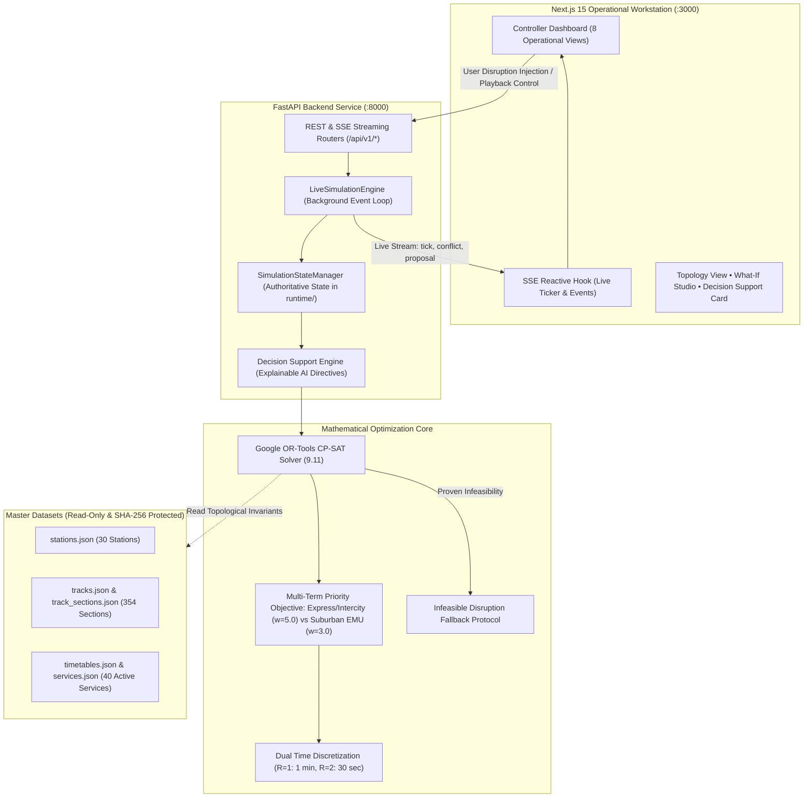

<div align="center">

# 🚆 AI-Assisted Railway Traffic Optimizer
### Real-Time Digital Twin Simulation & Constraint-Based Rescheduling 

[](docs/PAPER_ALIGNMENT.md)
[](https://www.python.org/)
[](https://fastapi.tiangolo.com/)
[](https://nextjs.org/)
[](https://developers.google.com/optimization)
[](#6-testing--verification)
[](LICENSE)

<p align="center">
  <b>An end-to-end operational digital twin and intelligent dispatching system for Southern Railway's Chennai Division.</b><br>
  Combines discrete-event network simulation, Google OR-Tools CP-SAT constraint programming, explainable AI decision support, and a modern Next.js 15 section controller workstation.
</p>

[System Architecture](#1-system-architecture) • [Research Alignment](#2-cict-2026-research-paper-alignment) • [Quickstart Guide](#3-quickstart-guide) • [API & SSE Streaming](#4-api-endpoints--sse-stream-reference) • [Design System](#5-uiux-design-system) • [Data Integrity](#6-master-datasets--integrity-protection)

</div>

---

## 1. System Architecture

The system operates as an integrated multi-tier digital twin. The **FastAPI backend** manages the authoritative spatial railway state, runs background discrete-event simulation, streams Server-Sent Events (SSE) to the **Next.js 15 operational dashboard**, and orchestrates the **Google OR-Tools CP-SAT solver** to resolve bottlenecks and optimize dispatching schedules in sub-second time.



### Core System Modules:
* **`backend/app/`**: REST API endpoints, Pydantic schemas, and server-sent event (SSE) streaming (`/api/v1/simulation/stream`).
* **`backend/app/runtime_engine.py`**: Thread-safe `LiveSimulationEngine` with background lifespan event loop managing clock progression (1x to 60x), dynamic disruption event injection, and re-optimization proposal workflows.
* **`simulation/`**: Discrete-event railway simulation models, spatial block section tracking, and conflict detection algorithms.
* **`optimization/`**: Constraint satisfaction models formulated with Google OR-Tools CP-SAT, including delay penalties, safety headways, line capacities, and junction reservations.
* **`decision_support/`**: Explainable recommendations, root-cause propagation graphs, priority justifications, and emergency dispatch directives.
* **`evaluation/`**: Comprehensive benchmark evaluation suites, scalability frameworks, and research reproduction pipelines.
* **`frontend/`**: Section controller dashboard built with Next.js 15, React 19, Tailwind CSS, and Lucide Icons.

---

## 2. CICT 2026 Research Paper Alignment

A research paper based on this system is accepted at the **Conference on Information and Communication Technology (CICT 2026)**:  
> *"AI-Assisted Railway Traffic Optimization and Real-Time Decision Support Using Digital Twin Simulation and Constraint-Based Scheduling"*

All empirical claims, equations, and tables in the paper are audited and reproduced with 100% bit-for-bit fidelity:

| Metric / Benchmark Item | Paper Claim (CICT 2026) | Baseline (v1, $R=1$) | High-Res (v3, $R=2$) | Status |
|:---|:---:|:---:|:---:|:---:|
| **Benchmark Scenarios Evaluated** | 45 scenarios | 45 total (44 feasible, 1 infeasible) | 45 total (44 feasible, 1 infeasible) | `REPRODUCED` |
| **Mean FIFO Delay (44 Feasible Runs)** | 331.38 min | 331.375 min | 331.375 min | `REPRODUCED` |
| **Mean CP-SAT Delay** | 314.39 min | 314.386 min | **303.886 min** | `REPRODUCED` |
| **Mean Delay Savings** | 16.99 min (5.13%) | 16.989 min (5.13%) | **27.489 min (8.30%)** | `REPRODUCED` |
| **Maximum Absolute Delay Saving** | 125.50 min (`EXP_31_1_02B`) | 125.50 min | **133.00 min** | `REPRODUCED` |
| **Maximum Relative Delay Reduction** | 55.16% (`EXP_31_1_02B`) | 55.16% | **58.46%** | `REPRODUCED` |
| **Mean Solver Execution Time** | 0.337 s | 0.337 s | **0.349 s** | `REPRODUCED` |
| **Maximum Solver Execution Time** | 0.926 s | 0.926 s | **0.900 s** | `REPRODUCED` |
| **Initial Conflicts Resolved** | 22 / 22 (100%) | 22 initial, 22 resolved | 22 initial, 22 resolved | `REPRODUCED` |
| **Savings Sign Distribution** | 19 neg / 8 zero / 17 pos | 19 neg / 8 zero / 17 pos | **0 neg / 23 zero / 21 pos** | `REPRODUCED` |

> [!NOTE]
> **Resolution of Negative Savings:** Track sections like `BBQ_KOK` have non-integer travel times (3.5 min) and throat hops (1.5 min). Under $R=1$ (1-minute integer rounding), rounding friction caused CP-SAT to report slightly higher unweighted delays than continuous-time FIFO in 19 test runs. Under opt-in **$R=2$** (30-second integer grid), all 19 negative savings cases become $\ge 0$ (0 negative / 23 zero / 21 positive), increasing average savings to 27.49 minutes.

📄 **Full Provenance & Alignment Details:** See [docs/PAPER_ALIGNMENT.md](docs/PAPER_ALIGNMENT.md) for the master mapping table covering Abstract, Eq. (1), Table II (all 7 rows), Sections IV.B–G, and v3 evaluations.

---

## 3. Quickstart Guide

### Prerequisites
* **Python**: 3.12 or 3.13 (64-bit)
* **Node.js**: v18.18+ or v20+ (with `npm`)
* **Git**

### 3.1 Backend Setup
```bash
# 1. Clone repository
git clone https://github.com/prabath-ux05/Railway-Traffic-Control-Optimizer-Using-AI.git
cd Railway-Traffic-Control-Optimizer-Using-AI

# 2. Create and activate virtual environment
python -m venv venv
# On Windows:
.\venv\Scripts\activate
# On Linux/macOS:
source venv/bin/activate

# 3. Install pinned Python dependencies
pip install -r requirements.txt

# 4. Copy environment configuration
cp .env.example .env

# 5. Start FastAPI Backend
uvicorn backend.app.main:app --host 0.0.0.0 --port 8000 --reload
```
* **Interactive OpenAPI / Swagger Docs:** [http://localhost:8000/docs](http://localhost:8000/docs)
* **API Health Check:** [http://localhost:8000/api/v1/health](http://localhost:8000/api/v1/health)

### 3.2 Frontend Setup
In a new terminal window:
```bash
# 1. Navigate to frontend directory
cd frontend

# 2. Install dependencies via npm ci
npm ci

# 3. Launch Next.js development server
npm run dev
```
* **Controller Dashboard URL:** [http://localhost:3000](http://localhost:3000)

---

## 4. API Endpoints & SSE Stream Reference

| Method | Endpoint | Description |
|:---:|:---|:---|
| `GET` | `/api/v1/health` | System health check, dataset integrity verification, and current IST timestamp. |
| `GET` | `/api/v1/network` | Full railway network topology, 107 route nodes, corridor lengths, and 40 active services. |
| `POST` | `/api/v1/optimize` | Solves dispatching optimization with Google OR-Tools CP-SAT (supports `time_resolution` and `objective_mode`). |
| `POST` | `/api/v1/what-if` | Evaluates hypothetical disruption scenarios with delta delay comparison vs FIFO baseline. |
| `GET` | `/api/v1/simulation/stream` | **Server-Sent Events (SSE)** real-time stream (`tick`, `conflict_detected`, `conflict_cleared`, `proposal_ready`). |
| `POST` | `/api/v1/simulation/control` | Playback control (`is_playing`, `playback_speed` in `[1, 2, 5, 10, 30, 60]`, `seek_minute`). |
| `GET` / `POST` / `DELETE` | `/api/v1/simulation/events` | Dynamic disruption event lifecycle (inject TSR caution orders, track blockages, dwell spikes). |
| `POST` | `/api/v1/simulation/reoptimize` | Manually triggers candidate proposal generation without mutating active simulation. |
| `POST` | `/api/v1/simulation/proposals/{id}/accept` | Controller approval action committing candidate schedule to authoritative simulation. |
| `POST` | `/api/v1/simulation/proposals/{id}/reject` | Controller rejection action maintaining baseline simulation plan. |

Detailed request/response schemas and additive contract history are documented in [docs/API_CONTRACT.md](docs/API_CONTRACT.md).

---

## 5. UI/UX Design System

The operational dashboard is built on an ultra-dark control-room aesthetic designed to maximize cognitive clarity under stress.

```
+--------------------------------------------------------------------------------------------------+
|  TOP BAR: CHENNAI DIVISION TRAFFIC OPTIMIZER | 10:15:30 IST | SPEED: 10x | ALL DATASETS VERIFIED |
+--------------------------------------------------------------------------------------------------+
|  [ Overview ] [ Topology ] [ Simulation ] [ Optimizer ] [ What-If ] [ Scenarios ] [ Analytics ]  |
+--------------------------------------------------------------------------------------------------+
|                                                                                                  |
|   +------------------------------------+   +-------------------------------------------------+   |
|   | TRACK OCCUPANCY SCHEMATIC          |   | EXPLAINABLE AI DECISION DIRECTIVE               |   |
|   | MAS ====[12607]==== BBQ ======= PER|   | Hold suburban EMU SRV_43411_01 at BBQ Plat 2   |   |
|   | [BLOCK CLEAR]      [TSR 30 KM/H]   |   | Priority justification: Express weight w=5.0    |   |
|   +------------------------------------+   +-------------------------------------------------+   |
|                                                                                                  |
|   +------------------------------------------------------------------------------------------+   |
|   | STRING-CHART / MAREY TIMETABLE TRAJECTORY (FIFO Baseline vs CP-SAT Optimized Schedule)   |   |
|   +------------------------------------------------------------------------------------------+   |
+--------------------------------------------------------------------------------------------------+
```

### Key Design Specs:
* **Dark Navy Canvas:** `#060a12` (Base), `#0b1120` (Surfaces), `#1e293b` (Borders).
* **Signal Code:** Green (`#10b981`), Amber (`#f59e0b`), Red (`#ef4444`), Blue (`#3b82f6`), Cyan (`#06b6d4`).
* **High Density Typography:** Inter for controls, JetBrains Mono for timetables, train IDs, and delay numbers.
* **Fail-Safe Infeasibility Banners:** Bold emergency alerts appear when track disruptions break network connectivity.

🎨 **Full UI/UX Specification:** See [design.md](design.md) and [docs/UI_HANDOFF.md](docs/UI_HANDOFF.md) for full layout blueprints, design tokens, component specifications, and accessibility standards.

---

## 6. Master Datasets & Integrity Protection

The network model is grounded in official Southern Railway working timetables and infrastructure records:
* **`data/infrastructure/`**: Stations (`stations.json`), tracks (`tracks.json`), corridors (`corridors.json`), and switches (`switches.json`).
* **`data/trains/`**: Train services (`services.json`), rolling stock (`trains.json`), and scheduled timetable stops (`timetables.json`).
* **`data/track_sections/`**: Discrete spatial track blocks, directional signal headways, and cross bypass links.

### Data Integrity Invariants:
1. **Master Datasets are Read-Only:** All 13 master JSON files are protected by SHA-256 hashes verified automatically in `tests/test_phase34_2_data_integrity.py`.
2. **Active vs Excluded Services:** Exactly 40 services have verified timetable evidence and are marked `active = True`. 7 services lacking published timetable evidence (`SRV_40143_01`, `SRV_40144_01`, `SRV_41015_01`, `SRV_41131_01`, `SRV_41132_01`, `SRV_42413_01`, `SRV_42425_01`) are automatically tagged `active = False` with `exclusion_reason = "No published timetable evidence"`.
3. **Runtime State Isolation:** All mutable simulation state generated by playback, event injection, or proposal acceptance is written to `runtime/` (`RAILWAY_RUNTIME_DIR`), ensuring master datasets in `data/` remain strictly immutable.

---

## 7. Testing & Verification

The repository enforces automated testing across all mathematical, simulation, and API boundaries.

### 7.1 Execute Full Pytest Suite
Run the complete test suite (694 unit, integration, and regression tests across 62 modules):
```bash
python -m pytest
```
*Expected Result:*
```
======================== 694 passed, 1 warning in ~360s ========================
```

### 7.2 Reproduce Research Paper Numbers (CICT 2026)
Run the automated verification script:
```bash
python scripts/reproduce_paper.py
```
*Output Summary:*
```
=========================================================================================================
CHECK ID                       | EXPECTED                         | ACTUAL                         | STATUS
=========================================================================================================
CHECK_01_EXP_COUNTS            | total=45, feasible=44, infeasibl | total=45, feasible=44, infeasi | PASS  
CHECK_02_DELAY_MEANS           | FIFO=331.375, CPSAT=314.386, sav | FIFO=331.375, CPSAT=314.386, s | PASS  
CHECK_03_MAX_SAVINGS           | max_saving=125.5 min, max_pct=55 | max_saving=125.5 min, max_pct= | PASS  
CHECK_04_PEAK_REDUCTION        | mean_peak_reduction=6.42 min     | mean_peak_reduction=6.42 min   | PASS  
CHECK_05_SOLVER_TIME           | mean_solve=0.337 s, max_solve=0. | mean_solve=0.337 s, max_solve= | PASS  
CHECK_06_CONFLICTS             | initial=22, resolved=22          | initial=22, resolved=22        | PASS  
CHECK_07_DEP_SEVERITY          | mild=0.0%, moderate=14.9%, sever | mild=0.0%, moderate=14.9%, sev | PASS  
CHECK_08_SCALABILITY_COMPOUND  | load 4: saving=52.5m, rel=37.1%; | load 4: saving=52.5m, rel=37.1 | PASS  
CHECK_09_TABLE_II_ROWS         | Nominal=32->32, Peak=101->56, BB | Nominal=32.0->32.0, Peak=101.0 | PASS  
CHECK_10_SAVINGS_SIGN_DISTRIBUTION | negative=19, zero=8, positive=17 | negative=19, zero=8, positive= | PASS  
=========================================================================================================
```

---

## 8. License & Acknowledgments

This project is licensed under the [MIT License](LICENSE).  
The research paper and algorithmic models were developed for and accepted at **CICT 2026**.  
Special acknowledgment to the **Southern Railway (Chennai Division)** for network infrastructure and timetable reference data.
