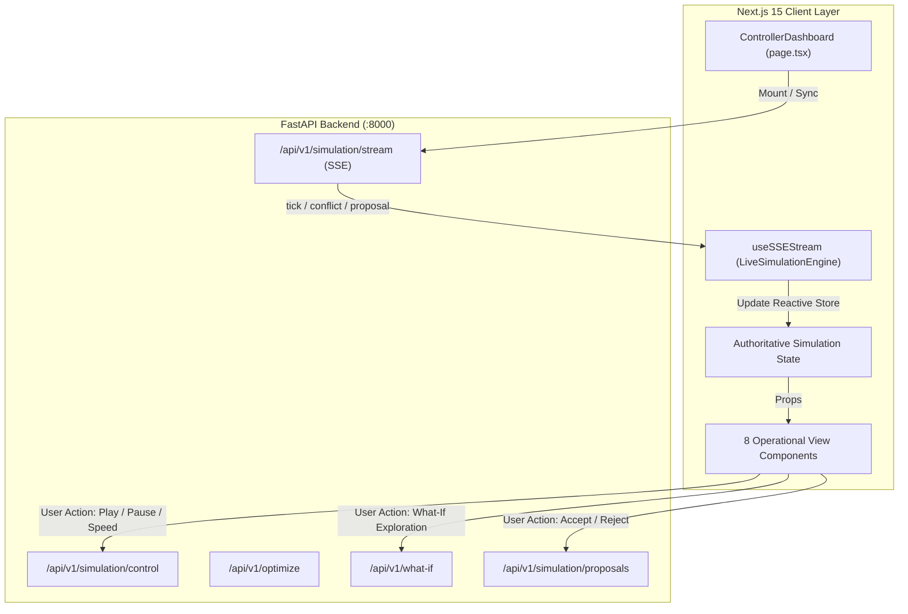

# Railway Traffic Optimizer — Website & Dashboard UI/UX Design System

**Document Version:** 2.0  
**Target Platform:** Next.js 15 (App Router), React 19, Tailwind CSS, Lucide Icons  
**Target Domain:** Southern Railway — Chennai Division (Suburban & Mainline Corridors)  
**Reference Conference:** CICT 2026 Accepted Research Paper  

---

## 1. Design Vision & Philosophy

The **Railway Traffic Optimizer Operational Dashboard** is a mission-critical web application designed for Section Controllers, Dispatchers, and Railway Traffic Analysts. The user interface translates complex mathematical optimization (Google OR-Tools CP-SAT) and continuous discrete-event simulation into instantaneous, actionable visual intelligence.

```
+----------------------------------------------------------------------------------------------------+
|                                    MISSION-CRITICAL DESIGN PILLARS                                  |
+-----------------------------------+-----------------------------------+----------------------------+
| 1. High Cognitive Bandwidth       | 2. Zero-Latency Feedback          | 3. Explainable Autonomy    |
| Dense, high-contrast typography   | Server-Sent Events (SSE) stream   | Every optimization action  |
| and spatial track schematics      | updates at up to 60x simulation   | displays root causes,      |
| deliver situational awareness     | speed without blocking UI         | trade-offs, and priority   |
| in under 500 milliseconds.        | interactivity or rendering.       | weight justifications.     |
+-----------------------------------+-----------------------------------+----------------------------+
```

### Inspiration & Aesthetics
- **European Train Control System (ETCS) & Indian Railways Traffic Management System (TMS):** Dark control-room ergonomics, high-contrast signal status indicators, and spatial track block visualization.
- **Modern Aerospace Telemetry:** Monospaced timing readouts, unambiguous severity color-coding, split-second emergency banners, and non-modal proposal review workflows.

---

## 2. Design Tokens & Color System

The application utilizes an ultra-dark navy palette (`railway-*`) coupled with standardized railway signal colors (`signal-*`).

### 2.1 Color Palette

```
+--------------------------------------------------------------------------------------------------+
| PALETTE NAME     | HEX CODE  | RGB              | PURPOSE / USAGE                                |
+------------------+-----------+------------------+------------------------------------------------+
| railway-950      | #060a12   | rgb(6, 10, 18)   | Deepest viewport background (canvas base)      |
| railway-900      | #0b1120   | rgb(11, 17, 32)  | Card surfaces, secondary containers, sidebars  |
| railway-850      | #0f172a   | rgb(15, 23, 42)  | Elevated panels, dropdowns, modal drawers      |
| railway-800      | #1e293b   | rgb(30, 41, 59)  | Primary borders, divider lines, grid tracks    |
| railway-700      | #334155   | rgb(51, 65, 85)  | Interactive hover borders, muted icons         |
| railway-600      | #475569   | rgb(71, 85, 105) | Tertiary text, table headers, axis labels      |
+------------------+-----------+------------------+------------------------------------------------+
| signal-green     | #10b981   | rgb(16, 185, 129)| Clear track block, on-time service, optimal    |
| signal-amber     | #f59e0b   | rgb(245, 158, 11)| Caution aspect, moderate delay, TSR warning    |
| signal-red       | #ef4444   | rgb(239, 68, 68) | Conflict, occupied block, blockage, emergency  |
| signal-blue      | #3b82f6   | rgb(59, 130, 246)| Express service priority ($w_i=2.0$), active   |
| signal-cyan      | #06b6d4   | rgb(6, 182, 212) | Optimized trajectory, re-optimization proposal |
| signal-purple    | #8b5cf6   | rgb(139, 92, 246)| Decision support directive, AI recommendation  |
+--------------------------------------------------------------------------------------------------+
```

### 2.2 Typography Hierarchy

```
+--------------------------------------------------------------------------------------------------+
| LEVEL            | FONT FAMILY         | SIZE / WEIGHT     | APPLIED TO                          |
+------------------+---------------------+-------------------+-------------------------------------+
| Display Heading  | Inter / Geist Sans  | 24px (1.5rem) / 700| Application Title, Active Station   |
| Section Header   | Inter / Geist Sans  | 18px (1.125rem)/600| View titles, Modal headers          |
| Card Header      | Inter / Geist Sans  | 14px (0.875rem)/600| Card captions, KPI labels           |
| Body Regular     | Inter / Geist Sans  | 13px (0.8125rem)/400| Descriptions, explanatory tooltips |
| Telemetry / Data | JetBrains Mono / SF | 13px (0.8125rem)/500| Timetables, Delays, Coordinates     |
| Monospace Micro  | JetBrains Mono / SF | 11px (0.6875rem)/600| Train IDs (`SRV_12607_01`), Hashes  |
+--------------------------------------------------------------------------------------------------+
```

---

## 3. Global Information Architecture & Navigation

The controller dashboard is organized into eight specialized operational views accessible via a fixed top navigation bar.

```
+----------------------------------------------------------------------------------------------------+
|  [LOGO] CHENNAI DIVISION RAILWAY TRAFFIC OPTIMIZER | LIVE 10:15:30 IST | SPEED: 10x | SYNC [OK]    |
+----------------------------------------------------------------------------------------------------+
|  [ Overview ] [ Topology ] [ Simulation ] [ Optimizer ] [ What-If ] [ Scenarios ] [ Timetable ] [ Analytics ] |
+----------------------------------------------------------------------------------------------------+
|                                                                                                    |
|                                        ACTIVE VIEW CONTAINER                                       |
|                                                                                                    |
+----------------------------------------------------------------------------------------------------+
|  SYSTEM HEALTH: ALL 13 DATASETS VALIDATED (SHA-256) | 40 ACTIVE SERVICES | ENGINE: RUNNING (SSE)   |
+----------------------------------------------------------------------------------------------------+
```

### Navigation Map
1. **Overview (`overview`):** Executive summary KPI cards, critical conflict ledger, punctuality indexes, and recent disruption timeline.
2. **Network Topology (`topology`):** Linear schematic track diagram, station platform allocations, and block section signals.
3. **Simulation Monitor (`monitor`):** Real-time spatial tracking, playback tape (1x–60x, pause, seek), and event injection drawer.
4. **Optimization Panel (`optimizer`):** CP-SAT solver invocation, objective function toggle (`WEIGHTED` vs `TOTAL_DELAY`), resolution slider ($R=1$ vs $R=2$), and solution metrics.
5. **What-If Studio (`whatif`):** Disruption modeling sandbox (TSR cautions, dwell spikes, throat blockages) with delta delay projections.
6. **Scenario Comparison (`scenarios`):** Benchmark comparative matrix (Table II disruption presets vs CP-SAT schedule).
7. **Timetable Comparison (`timetable`):** Interactive String-Chart (Marey diagram) and tabular timetable comparison (Original vs Baseline vs Optimized).
8. **Research Analytics (`analytics`):** CICT 2026 conference research telemetry, bottleneck heatmaps, solver runtime profiles, and paper alignment matrix.

---

## 4. Detailed View & Component Specifications

### 4.1 Global Header (`Header.tsx`)
* **Live System Telemetry:** Displays current simulation clock (HH:MM IST), engine status (`RUNNING`, `PAUSED`, `IDLE`), active speed multiplier (`1x`, `2x`, `5x`, `10x`, `30x`, `60x`), and connected SSE stream heartbeat indicator.
* **Integrity Status Pill:** Green badge indicating all 13 master datasets have verified SHA-256 checksums (`tests/test_phase34_2_data_integrity.py`). Amber badge if warnings exist.
* **Controller Playback Controls:**
  - Play / Pause toggle with immediate state reflection.
  - Speed selector dropdown (`1x` to `60x`). Note: `playback_speed = N` advances $N$ simulation minutes per 60 real-world seconds.
  - Manual Seek slider to scrub through the 24-hour dispatching horizon.

---

### 4.2 Network Topology View (`NetworkTopologyView.tsx`)
A linear schematic track diagram representing the Chennai Division corridors:
* **West Corridor (Chennai Central – Arakkonam):** 31 nodes, 4 tracks (UP Fast, DOWN Fast, UP Slow, DOWN Slow) connecting MAS, BBQ, VJM, PER, PCW, PEW, VLK, KOTR, PVM, ABU, TMVL, ANNR, AVD, HC, PRES, PAB, PTMS, NEC, TI, VEU, SVR, PTLR, TRL, EGT, KBT, SPAM, MAF, TO, MSU, PLMG, AJJ.
* **South Corridor (Chennai Beach – Chengalpattu):** Double-track electrified mainline with dedicated suburban EMU tracks connecting MSB, MS, MBM, SP, STM, PV, CMP, TBM, PRGL, VDR, UPM, GI, CTM, POT, MMNK, SKL, PWU, CGL.
* **MRTS Elevated Line (Beach – Velachery):** 18 elevated nodes (MSB, MCPT, MCPK, TRMN, VLCY, etc.).

#### Visual Conventions for Track Blocks:
- **Grey Line (`railway-800`):** Unoccupied, clear track block.
- **Solid Green (`signal-green`):** Track section reserved by approaching on-time train.
- **Solid Amber (`signal-amber`):** Track section subject to Temporary Speed Restriction (TSR caution order).
- **Flashing Red (`signal-red`):** Track block occupied or subject to complete blockage/failure.
- **Blue Train Pill:** Train service positioned on block with service code (`12607`), speed (km/h), and current delay ($+12\text{m}$).

---

### 4.3 Simulation Monitor (`SimulationMonitor.tsx`)
Real-time discrete-event monitor powered by `/api/v1/simulation/stream`:
* **Real-time Event Stream:** Displays live notifications for `conflict_detected`, `conflict_cleared`, `event_injected`, and `proposal_ready`.
* **Dynamic Event Injector:**
  - **TSR Injection:** Select corridor, from-station, to-station, max speed (km/h), and active duration.
  - **Blockage Injection:** Simulate physical line blockage (e.g. MAS–BBQ throat link closure).
  - **Dwell Spike:** Inject excessive station dwell time (e.g. Perambur passenger surge).
* **Live Re-optimization Flow:** When an event is injected, the engine broadcasts `conflict_detected` followed by `proposal_ready`. The controller can inspect the candidate plan and click **Accept** (commits to authoritative simulation) or **Reject** (maintains existing baseline).

---

### 4.4 Decision Support Card (`ExplainableRecommendationCard.tsx`)
Whenever conflicts or disruptions occur, the decision support engine synthesizes a structured, explainable recommendation:

```
+----------------------------------------------------------------------------------------------------+
| [AI DIRECTIVE: PRIORITY PRECEDENCE]                                            CONFIDENCE: 98.4%   |
| RECOMMENDATION: Hold suburban EMU SRV_43411_01 at Basin Bridge Platform 2 for 4.5 minutes.         |
+----------------------------------------------------------------------------------------------------+
| ROOT CAUSE ANALYSIS:                                                                               |
| * Primary Disruption: Lalbagh Express (SRV_12607_01) delayed +20 min arriving from Katpadi.       |
| * Propagated Bottleneck: Contention at BBQ Junction Switch SW_04B between Express and Suburban.    |
| * Justification: Express weight ($w_i=2.0$) supersedes EMU weight ($w_i=1.0$). Reversing precedence |
|   would save 4.5m for EMU but cascade +22.0m delay onto 3 downstream express services.             |
+----------------------------------------------------------------------------------------------------+
| PROJECTED DELAY SAVINGS: -17.5 min system-wide  |  AFFECTED SERVICES: 2  |  SAFETY HEADWAY: 3.0 min|
+----------------------------------------------------------------------------------------------------+
| [ ACCEPT & DISPATCH PROPOSAL ]                                        [ REJECT (MAINTAIN FIFO) ]   |
+----------------------------------------------------------------------------------------------------+
```

#### Emergency Fallback Protocol (Infeasible Handling):
When disruptions completely sever track connectivity (e.g. MAS–BBQ total throat link closure in `EXP_31_3_12_BLK_SEVERE`), CP-SAT mathematically proves that no conflict-free schedule exists (`solution_available = false`).
- The UI replaces the standard savings cards with an **Emergency Red Banner**:
  `"CRITICAL: INFEASIBLE SCHEDULE DETECTED — Severe Throat Link Closure. Mathematical constraints prevent safe timetable synthesis."`
- The top action displays category `"EMERGENCY"` with recommendations for track maintenance diversion, bus bridging, or train termination.

---

### 4.5 What-If Studio (`WhatIfStudio.tsx`)
A comparative sandbox enabling controllers to explore hypothetical dispatch decisions:
* **Inputs:** Multi-select active services (40 available), toggle `apply_midnight_wrap` (on/off), choose `time_resolution` ($R=1$ for 1-minute paper reproduction vs $R=2$ for 30-second exact resolution), and select `objective_mode` (`WEIGHTED` vs `TOTAL_DELAY`).
* **Visual Outputs:**
  - **Delay Comparison XY Chart:** Side-by-side bar chart showing FIFO baseline vs CP-SAT optimized delay per train.
  - **Platform Occupancy Gantt Chart:** Platform utilization at MAS, BBQ, TBM, AJJ.
  - **Delta Delay Metric Badge:** Shows exact minutes saved ($\Delta \text{Delay}$) and relative percentage.

---

### 4.6 Research Analytics View (`ResearchAnalyticsView.tsx`)
Dedicated analytics dashboard presenting the CICT 2026 conference research findings:
* **10-Check Automated Verification Status:** Live badges showing 10/10 PASS from `scripts/reproduce_paper.py`.
* **Disruption Severity Breakdown:** Interactive cards displaying savings across mild, moderate, and severe disruptions.
* **Paper Alignment Matrix:** Direct embedded reference to [docs/PAPER_ALIGNMENT.md](file:///c:/Users/praba/OneDrive/Documents/railway-traffic-optimizer/docs/PAPER_ALIGNMENT.md) mapping Abstract, Table II, Sec. IV.B–G, Eq. (1) mathematical formulation, and v3 evaluation.

---

## 5. Responsive Design & Accessibility (a11y)

### 5.1 Responsive Breakpoints
* **Mobile / Tablet ( < 1024px ):** Compact vertical card stack with collapsible navigation drawer; track schematic switches to vertical milestone list.
* **Standard Desktop ( 1024px – 1440px ):** 12-column layout with fixed top bar, dual-column telemetry cards, and horizontal scrolling track schematic.
* **Ultra-wide Dispatcher Display ( > 1440px ):** Full panoramic layout with multi-panel simultaneous monitoring (Track schematic on top 50%, Timetable string chart and Decision Support side-by-side on bottom 50%).

### 5.2 Accessibility Standards
* **Color Blindness Safe:** Every signal indicator couples color with an icon (e.g. Signal Red accompanied by a hazard triangle, Signal Green by a check circle).
* **WCAG 2.1 AAA Contrast:** All text on `railway-950` and `railway-900` backgrounds maintains a contrast ratio $> 7:1$.
* **Keyboard Navigation:** Full keyboard navigation support (Tab order through playback controls, arrow navigation across train nodes, Enter/Space to accept proposals).

---

## 6. Frontend State Management Architecture



---

## 7. Quality Checklist for Frontend Developers

- [ ] **No Hard-coded Delays:** Never hard-code delay numbers or mock data; always read from `RailwayApi`.
- [ ] **Handle Infeasible Gracefully:** When `solution_available=false`, delay fields are `null`. Never default to `0 min`.
- [ ] **Respect Excluded Services:** 7 services (`SRV_40143_01`, etc.) are inactive (`active=false`); style them with muted grey badges and disable optimization toggles.
- [ ] **Speed Semantics:** `playback_speed = N` means $N$ simulation minutes advance in 60 real-world seconds.
- [ ] **Time Resolution Echo:** Display active time resolution ($R=1$: 1 min, $R=2$: 30 sec) in solver telemetry.
