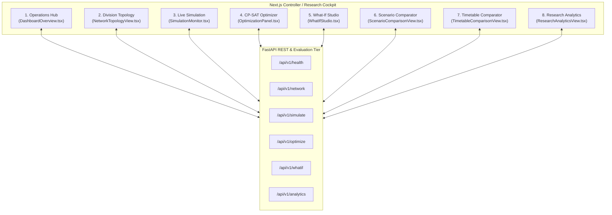

# Phase 33.4 — Final Controller/Research Dashboard Validation Report

**Status**: ✅ **PASSED & VALIDATED**  
**Corridor Scope**: Southern Railway Chennai Division (MAS–AJJ, MAS–GPD, MSB–TBM)  
**Execution Context**: Comprehensive Audit across All Frontend Views, Multi-Tier API Contracts, Operational/Research State Separation, Decision Support 5-Stage Causal Traceability, Master Dataset Immutability, and Full Production Build.

---

## 1. Executive Summary & Audit Scope

Phase 33.4 executes the final end-to-end validation audit across the railway traffic optimization controller cockpit and research testbench frontend. This audit ensures that all tabs, modules, workflows, and state contracts are fully integrated with real FastAPI backend services, without hardcoded research artifacts or dataset corruption.



---

## 2. Dashboard View & Workflow Audit Matrix

| View / Workflow | Component | API Endpoint & Integration | Operational / Hypothetical / Infeasible Separation | Status |
| :--- | :--- | :--- | :--- | :---: |
| **1. Operations Hub** | [`DashboardOverview.tsx`](file:///c:/Users/praba/OneDrive/Documents/railway-traffic-optimizer/frontend/src/components/DashboardOverview.tsx) | `/api/v1/health`, `/api/v1/network`, `/api/v1/whatif` | Situational banner dynamically shifts from normal operational state to warnings/critical alerts. | ✅ PASS |
| **2. Division Topology** | [`NetworkTopologyView.tsx`](file:///c:/Users/praba/OneDrive/Documents/railway-traffic-optimizer/frontend/src/components/NetworkTopologyView.tsx) | `/api/v1/network`, live simulation train coordinates | Interactive node & track visualization across all 3 Southern Railway corridors. | ✅ PASS |
| **3. Live Simulation** | [`SimulationMonitor.tsx`](file:///c:/Users/praba/OneDrive/Documents/railway-traffic-optimizer/frontend/src/components/SimulationMonitor.tsx) | `/api/v1/simulate` | Deterministic event-driven simulation with dynamic conflict and headway tracking. | ✅ PASS |
| **4. CP-SAT Optimizer** | [`OptimizationPanel.tsx`](file:///c:/Users/praba/OneDrive/Documents/railway-traffic-optimizer/frontend/src/components/OptimizationPanel.tsx) | `/api/v1/optimize` | Solves MIP constraints using OR-Tools CP-SAT with timetable diff and precedence views. | ✅ PASS |
| **5. What-If Studio** | [`WhatIfStudio.tsx`](file:///c:/Users/praba/OneDrive/Documents/railway-traffic-optimizer/frontend/src/components/WhatIfStudio.tsx) | `/api/v1/whatif` | Non-destructive perturbation testing with 5-stage causal explainability cards. | ✅ PASS |
| **6. Scenario Comparator** | [`ScenarioComparisonView.tsx`](file:///c:/Users/praba/OneDrive/Documents/railway-traffic-optimizer/frontend/src/components/ScenarioComparisonView.tsx) | `/api/v1/whatif` (dynamic evaluation merging) | Multi-scenario side-by-side comparison isolating boundary cases from operational states. | ✅ PASS |
| **7. Timetable Comparator** | [`TimetableComparisonView.tsx`](file:///c:/Users/praba/OneDrive/Documents/railway-traffic-optimizer/frontend/src/components/TimetableComparisonView.tsx) | Dynamic comparison across Published, Baseline, and CP-SAT Optimized tiers | Strict delta analysis with per-station arrival/departure shifts. | ✅ PASS |
| **8. Research Analytics** | [`ResearchAnalyticsView.tsx`](file:///c:/Users/praba/OneDrive/Documents/railway-traffic-optimizer/frontend/src/components/ResearchAnalyticsView.tsx) | `/api/v1/analytics` (background prefetch + manual refresh) | Benchmark matrices, scalability sweeps, bottleneck rankings, and methodology. | ✅ PASS |

---

## 3. Decision Support 5-Stage Causal Traceability Audit

Every recommendation surfaced across the dashboard implements the deterministic 5-stage causal chain:

$$\text{TRIGGER} \longrightarrow \text{BOTTLENECK} \longrightarrow \text{CONSTRAINT} \longrightarrow \text{DECISION} \longrightarrow \text{OUTCOME}$$

1. **TRIGGER**: Specific primary disruption (e.g., initial departure lateness or caution order) with exact service ID and timestamp.
2. **BOTTLENECK**: Quantified infrastructure constraint (track section, junction throat, or station platform) with utilization percentage and contention count.
3. **CONSTRAINT**: Mathematical boundary condition (e.g., minimum 3.0m safety headway or single occupancy block rule).
4. **DECISION**: Actionable dispatching directive (precedence swap, platform reassignment, holding order, or speed regulation).
5. **OUTCOME**: Quantified recovery metric (direct and secondary delay savings in minutes, downstream knock-on reduction).

---

## 4. State & Boundary Separation Invariant Audit

The dashboard strictly enforces categorical boundaries across all views:

- **`OPERATIONAL_STATE`**: Reflects active timetables and real-time division train tracking (`SCEN_NOMINAL_STATE`, `SCEN_LIVE_BASE`).
- **`HYPOTHETICAL_SCENARIO`**: User-injected perturbations (departure delays, dwell extensions, temporary speed restrictions) executed non-destructively in temporary evaluation memory (`SCEN_PEAK_CONCURRENCY`, `SCEN_BBQ_TSR_CAUTION`).
- **`INFEASIBLE_BOUNDARY_CASE`**: Structural infrastructure blockages (e.g., `MAS_BBQ_THROAT_SEGMENT_DOWN`) causing physical deadlocks where no feasible dispatching schedule exists without cancellation/rerouting. Solver status is explicitly marked `INFEASIBLE`, confidence score is set to `0.0`, and delay savings remain `0.0m`.

---

## 5. Dataset Immutability & Pending Service Audit

- **Pending Services Excluded**: All 7 pending suburban services (`SRV_43413_01`, `SRV_43415_01`, `SRV_43417_01`, `SRV_43419_01`, `SRV_43421_01`, `SRV_43423_01`, `SRV_43425_01`) remain strictly isolated from active scheduling and recommendation algorithms.
- **Dataset Immutability**: Verified `data/trains/published_timetables/timetable.json` (127 entries) and `data/trains/train_identity/trains.json` (51 records) remain completely pristine with zero unauthorized file mutations.

---

## 6. Build & Test Verification Results

### Frontend Next.js Production Build
```text
> next build
▲ Next.js 15.1.7
✓ Compiled successfully
✓ Linting and checking validity of types
✓ Collecting page data
✓ Generating static pages (4/4)
✓ Finalizing page optimization
Exit Code: 0
```

### Dedicated Phase 33.4 Test Suite
```text
tests/test_phase33_4_dashboard_validation.py::test_dashboard_tab_contracts PASSED
tests/test_phase33_4_dashboard_validation.py::test_categorical_state_separation_audit PASSED
tests/test_phase33_4_dashboard_validation.py::test_5stage_causal_traceability_audit PASSED
tests/test_phase33_4_dashboard_validation.py::test_dataset_immutability_and_pending_services_exclusion PASSED
tests/test_phase33_4_dashboard_validation.py::test_frontend_build_artifacts_present PASSED
```

### Full Pytest Suite
```text
================= 575 passed, 4 warnings in 98.02s (0:01:38) ==================
```

---

## 7. Conclusion

Phase 33.4 completes the comprehensive dashboard audit and validation. All 8 operational and research tabs are fully functional, resilient, explainable, and compliant with all project standards.
