# Phase 34.2 — Data Integrity & Immutability Audit Report

**Status**: ✅ **PASSED & 100% IMMUTABLE**  
**Audit Scope**: Master Dataset Cryptographic Invariants, Referential Integrity, Record Counts, Schema Conformance, 7 Pending Services Exclusion, and Zero Artifact Contamination.  
**Corridor Network**: Southern Railway Chennai Division (West MAS–AJJ, North MAS–GPD/SPE, South MSB–TBM/CGL, MRTS MSB–VLCY, PTMS Siding).

---

## 1. Executive Summary & Cryptographic Audit

Phase 34.2 executes a full cryptographic and schema integrity audit across all master JSON datasets in `data/`. Every file was verified against canonical SHA-256 cryptographic baselines, confirming that zero unauthorized file mutations, dataset contamination, or record drops have occurred during simulation, optimization, decision-support, or frontend operations.

```mermaid
flowchart LR
    subgraph MasterDatasets["Master Datasets (100% Immutable)"]
        D1["stations.json (30 stns)"]
        D2["platforms.json (14 plats)"]
        D3["junctions.json (7 jcts)"]
        D4["routes.json (24 routes)"]
        D5["trains.json (51 trains)"]
        D6["services.json (47 svcs)"]
        D7["timetable.json (127 stops)"]
        D8["track_sections (6 files / 354 tracks)"]
    end

    subgraph SecurityChecks["Integrity & Immutability Verification"]
        H["SHA-256 Hash Matching"]
        S["Schema Conformance"]
        FK["Referential & FK Validation"]
        P["Pending Service Isolation (7 Excluded)"]
        W["Read-Only Master Protection"]
    end

    MasterDatasets --> SecurityChecks
```



---

## 2. Master Dataset SHA-256 Cryptographic Hashes & Counts

| Dataset File | Category | Record Count | SHA-256 Cryptographic Hash | Immutability Status |
| :--- | :--- | :---: | :--- | :---: |
| `data/infrastructure/stations.json` | Infrastructure | **30** | `c1c3324c8f252a7f12fd7d0ce960e0c92c746945afdff1db15b71bc71fac14e3` | ✅ IMMUTABLE |
| `data/infrastructure/platforms.json` | Infrastructure | **14** | `6c8b85beaed15541cd20ed2e38c4f2e29add9373ef65149443f5a28f22ec74b1` | ✅ IMMUTABLE |
| `data/infrastructure/junctions.json` | Infrastructure | **7** | `abd203cfce1ca4cef39bb54b376b855807f792d30b8e94b237aca49a11461d45` | ✅ IMMUTABLE |
| `data/infrastructure/routes.json` | Infrastructure | **24** | `07afe8f4b093b7987fb09d8b857a0ac84610a47e3c1cfd5f0daaa0515e883708` | ✅ IMMUTABLE |
| `data/trains/train_identity/trains.json` | Rolling Stock | **51** | `ed28825c9753b7bc588ce2fb2b554913d529f5ab4f8c784bdba1b43580813be9` | ✅ IMMUTABLE |
| `data/trains/service_definitions/services.json` | Service Plan | **47** | `1b6386e4cf23472c9398cb79ba81f1353c0aee4592b19ab47666898a2a735b9d` | ✅ IMMUTABLE |
| `data/trains/published_timetables/timetable.json` | Timetable | **127** | `578529fa64a2dc0c9377ca596d6411cfac8466f1cbac04b22bedfc43b01d6a2d` | ✅ IMMUTABLE |
| `data/track_sections/beach_north_bypass_track_sections.json` | Tracks (Bypass) | **6** | `12119214b04a56ee56da3983e4238a8748cce64af8be1b6bfe4acee3c772ad5e` | ✅ IMMUTABLE |
| `data/track_sections/cross_bypass_track_sections.json` | Tracks (Cross) | **22** | `1eff5ecadc6d38868f741d9fd04df25a81fd8e196747e1d8dccd40b57a10b6ef` | ✅ IMMUTABLE |
| `data/track_sections/mrts_track_sections.json` | Tracks (MRTS) | **34** | `1964b01ec3d4a451233fa5193558e940dc7e8532029185a0694b7b62e2d2f54c` | ✅ IMMUTABLE |
| `data/track_sections/north_track_sections.json` | Tracks (North) | **70** | `814bc3e8a1a2ad75929d5366882c5b36825a854f9104dd1f17bd84922050387c` | ✅ IMMUTABLE |
| `data/track_sections/south_track_sections.json` | Tracks (South) | **108** | `9ab818ee510dce98d475e05ce2a3d2231c453e9f5a99a4441d1d2729d702a2cb` | ✅ IMMUTABLE |
| `data/track_sections/west_track_sections.json` | Tracks (West) | **114** | `9f6e8593263ade57f9f4efcd5b3b42bde37a5740b9296222381f88a17bcc994f` | ✅ IMMUTABLE |
| **Total Track Sections (6 Files)** | **Tracks (All)** | **354** | — | ✅ IMMUTABLE |

---

## 3. Referential Integrity & Foreign Key Audit

- **Train ID Integrity**: All 47 service definitions in `services.json` reference valid `train_id` values defined in `trains.json`. Zero orphaned rolling-stock references.
- **Route ID Integrity**: All 47 service definitions reference valid `route_id` values defined in `routes.json`. Zero missing route paths.
- **Timetable Service ID Integrity**: All 127 timetable stop entries reference valid `service_id` values in `services.json`.
- **Duplicate ID Audit**:
  - Station IDs: 0 duplicates across 30 stations.
  - Platform IDs: 0 duplicates across 14 platforms.
  - Junction IDs: 0 duplicates across 7 junctions.
  - Route IDs: 0 duplicates across 24 routes.
  - Train IDs: 0 duplicates across 51 trains.
  - Service IDs: 0 duplicates across 47 services.
  - (Service ID, Station ID) Timetable Pairs: 0 duplicate stops.

---

## 4. Pending Service Exclusion & Invariant Audit

The 7 pending services are strictly excluded from published timetable data and operational simulation/optimization:

1. `SRV_40143_01` (MSB–CGL Fast EMU)
2. `SRV_40144_01` (CGL–MSB Fast EMU)
3. `SRV_41015_01` (MSB–VLCY MRTS Fast)
4. `SRV_41131_01` (MSB–VLCY MRTS Late)
5. `SRV_41132_01` (VLCY–MSB MRTS Late)
6. `SRV_42413_01` (MMC–SPE Passenger)
7. `SRV_42425_01` (MMC–SPE Night Suburban)

**Audit Verification**: None of these 7 service IDs appear in `timetable.json` (127 entries), ensuring that only the 40 active backed services are evaluated during operational runs.

---

## 5. Artifact Segregation & Master Write-Protection

- **Zero In-Place Overwrites**: Simulation engines, CP-SAT solvers, and frontend APIs execute purely in stateless memory structures and non-destructive objects. Master JSON files are opened exclusively in read-only (`"r"` / `"rb"`) mode.
- **Evaluation Artifact Segregation**: All evaluation dumps, benchmark matrices, propagation graphs, and Markdown reports are written exclusively to `evaluation/`, `data/evaluation/`, or `.next/` build directories without mutating master input files.

---

## 6. Test & Verification Results

### Dedicated Phase 34.2 Test Suite
```text
tests/test_phase34_2_data_integrity.py::test_master_dataset_sha256_immutability PASSED
tests/test_phase34_2_data_integrity.py::test_dataset_exact_counts_and_inventory PASSED
tests/test_phase34_2_data_integrity.py::test_dataset_schema_conformance PASSED
tests/test_phase34_2_data_integrity.py::test_cross_reference_and_referential_integrity PASSED
tests/test_phase34_2_data_integrity.py::test_pending_services_isolation_invariant PASSED
```

### Full Repository Pytest Suite
```text
============================= test session starts =============================
platform win32 -- Python 3.13.1, pytest-9.1.1
collected 586 items

586 passed, 4 warnings in 81.31s (0:01:21)
```

### Frontend Next.js Production Build
```text
> next build
▲ Next.js 15.1.7
✓ Compiled successfully
✓ Linting and checking validity of types
✓ Collecting page data
✓ Generating static pages (4/4)
✓ Finalizing page optimization
Exit Code: 0
```

---

## 7. Conclusion

Phase 34.2 data integrity and immutability audit has passed with 100% compliance. All master datasets are cryptographically verified, referentially sound, and protected against unintended mutation.
